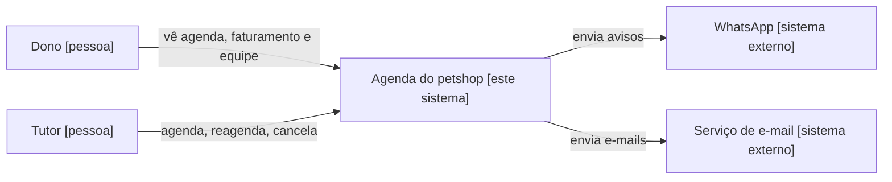
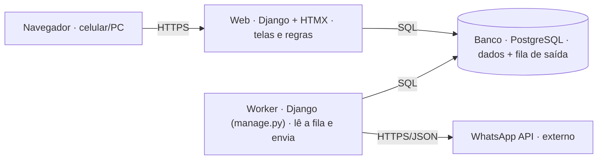
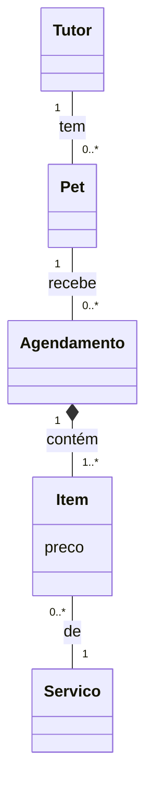

# Arquitetura: <nome do projeto>

Status: rascunho / aprovado · Base: `docs/projeto/prd.md` · Data: __/__/____

## 1. Contexto (C4 nível 1)
Quem usa o sistema e com quais sistemas de fora ele conversa. É o diagrama para o cliente entender.
- **Sem tecnologia** (nada de Django ou PostgreSQL aqui).
- Toda caixa tem **tipo**: `[pessoa]` ou `[sistema externo]`. Cada papel tem a sua caixa (dono, recepção e profissional são caixas diferentes).
- Toda seta tem **verbo**.
- Só entra quem fala direto com o sistema.

## 2. Containers (C4 nível 2)
O que roda. É o diagrama para o time técnico. Toda caixa tem **nome + tecnologia + o que faz**, e toda seta tem o **protocolo**.

Padrão da Septa: web + banco + worker com **fila de saída** (uma tabela no PostgreSQL). Celery/Redis só entram com uma ADR que mostre a necessidade medida.

## 3. Restrições
O que limita as escolhas. A arquitetura equilibra estas restrições com o PRD e com a seção 8, sem maximizar uma coisa só.
- **Técnicas** (hospedagem, sistema que o cliente já usa, integração obrigatória):
- **Do time** (quem vai manter, o que sabemos fazer):
- **Do projeto** (prazo, orçamento, LGPD, dado sensível):

## 4. Apps Django (áreas do negócio)
| App | Responsável por | Depende de |
|---|---|---|
| | | |

Entre apps só se importa `models.py`, `services.py` e `forms.py`/`serializers.py`. Nunca se importa `views.py`, templates ou função que começa com `_`.

## 5. Modelo de domínio
Os conceitos do negócio, com os nomes do glossário do PRD. É isso que o cliente valida. Não é o desenho das tabelas: `petshop_id`, tabela de ligação e índice ficam no código.

- Multiplicidade nas **duas pontas**. Leia assim: para **um** deste lado, quantos pode haver do outro?
- Toda multiplicidade é **confirmada com o cliente ou no model** (`null=True`, `unique`, `OneToOne`), nunca de cabeça.
- Atributo só aparece quando explica uma regra (ex.: `preco` no Item = preço congelado).

Regras: o que é obrigatório, o que é único, o que nunca é apagado.

## 6. Fluxos principais
O passo a passo dos 2 ou 3 caminhos mais importantes (ex.: "tutor agenda um horário").

## 7. Segurança e LGPD
- Papéis e o que cada um pode ver e editar (ex.: dono, recepção, profissional):
- Login: sessão do Django (padrão) ou outro? Ver `docs/SEGURANCA.md`.
- Dados pessoais guardados e por quê:
- Por quanto tempo guardamos e como apagamos:
- Pontos de ataque e como protegemos:

## 8. Requisitos de qualidade
Cada requisito é um cenário: **estímulo → resposta → medida**. "Rápido e seguro" não vale.

| Estímulo (o que acontece) | Resposta (como reage) | Medida (como saber) |
|---|---|---|
| Sexta 18h, 200 tutores buscam horário | mostra os horários livres sem erro | 95% das buscas em até 2 s; zero horário vendido duas vezes |
| O servidor cai às 3h | volta sozinho; o backup existe | no ar em até 30 min; perda máxima de 24 h |
| Funcionário abre ficha de outra empresa | bloqueia | 404 em 100% dos testes de isolamento |

Tempo se mede pelo **p95** (95% dos pedidos ficam abaixo), nunca pela média. Também vale anotar aqui: celular primeiro? Qual a meta de usabilidade do PRD?

## 9. Decisões (ADRs)
| Nº | Decisão | Arquivo |
|---|---|---|
| 0001 | | `adr/0001-....md` |

## 10. Riscos
| Risco | Chance | Impacto | O que fazer |
|---|---|---|---|
| | | | |
