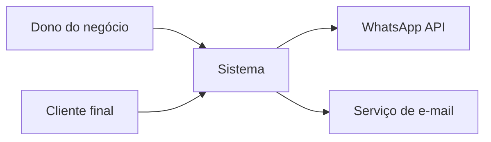
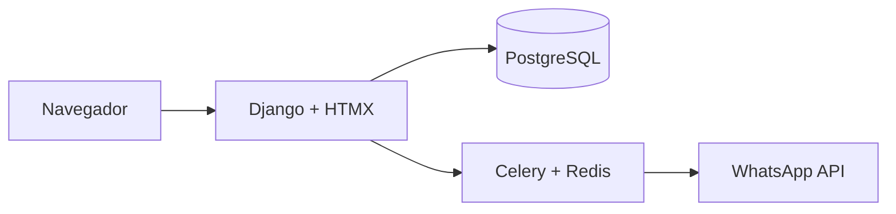
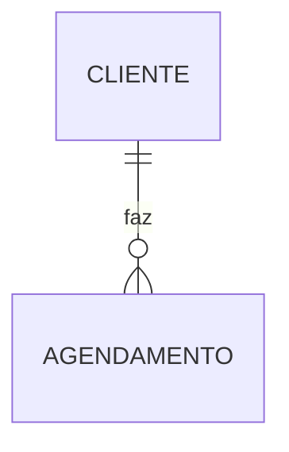

# Arquitetura: <nome do projeto>

Status: rascunho / aprovado · Base: `docs/projeto/prd.md` · Data: __/__/____

## 1. Contexto (C4 nível 1)
Quem usa o sistema e com quais sistemas de fora ele conversa.

## 2. Containers (C4 nível 2)
As partes que rodam: app web, banco, tarefas em segundo plano, serviços de fora.

## 3. Apps Django (áreas do negócio)
| App | Responsável por | Depende de |
|---|---|---|
| | | |

## 4. Modelo de dados

Regras: o que é obrigatório, o que é único, o que nunca é apagado.

## 5. Fluxos principais
Passo a passo dos 2 ou 3 caminhos mais importantes (ex.: "cliente agenda um horário").

## 6. Segurança e LGPD
- Quem pode ver/editar o quê (permissões por papel):
- Dados pessoais guardados e por quê:
- Por quanto tempo guardamos e como apagamos:
- Pontos de ataque e como protegemos:

## 7. Requisitos de qualidade
- Desempenho (ex.: página abre em menos de 2 s no 4G):
- Disponibilidade e backup:
- Celular primeiro?

## 8. Decisões (ADRs)
| Nº | Decisão | Arquivo |
|---|---|---|
| 0001 | | `adr/0001-....md` |

## 9. Riscos
| Risco | Chance | Impacto | O que fazer |
|---|---|---|---|
| | | | |
